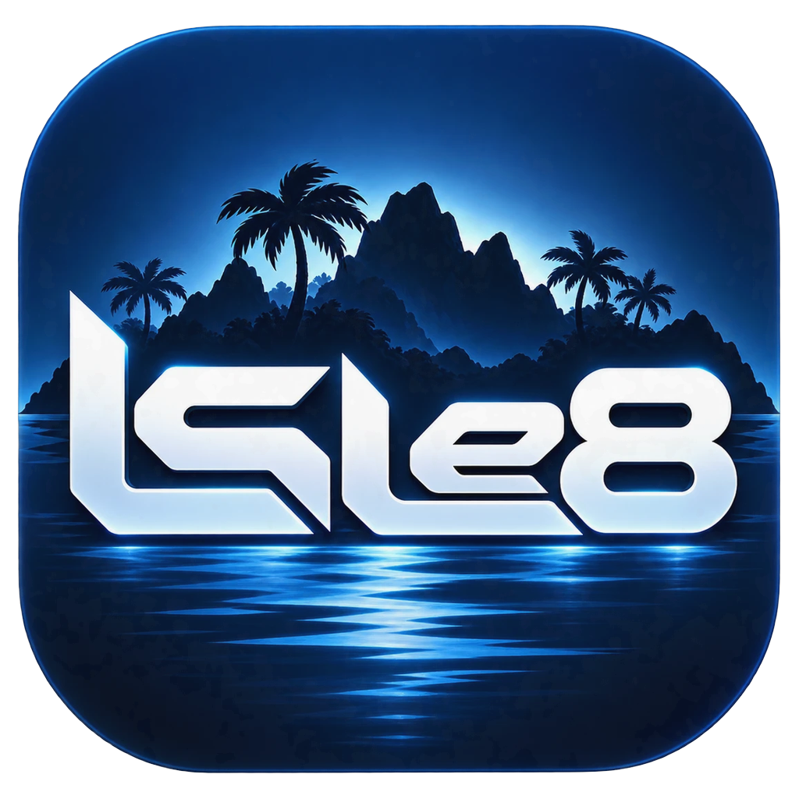
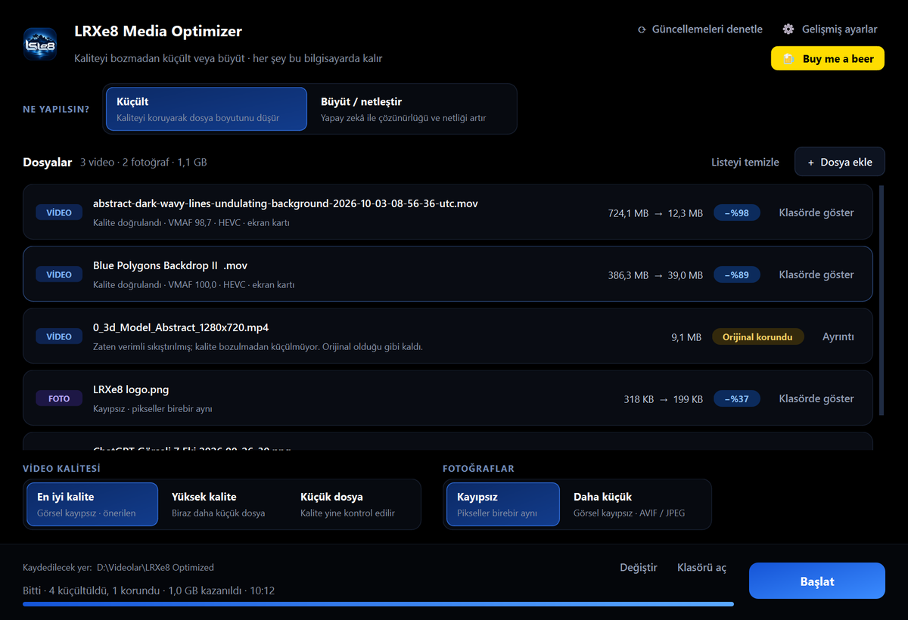

<p align="center"></p>

<h1 align="center">LRXe8 Media Optimizer</h1>

<p align="center">Video ve fotoğrafları <b>kaliteyi bozmadan küçülten</b> ve <b>yapay zekâ ile 4K'ya büyüten</b> yerel masaüstü uygulaması · Windows · macOS</p>

<p align="center">
  <a href="https://github.com/Mericsdc/LRXe8-Media-Optimizer/releases/latest"><b>⬇ En son sürümü indir</b></a>
  &nbsp;·&nbsp;
  <a href="CHANGELOG.md">Değişiklikler</a>
  &nbsp;·&nbsp;
  <a href="README-macOS.md">macOS</a>
</p>

<p align="center">
  <a href="https://www.buymeacoffee.com/Lurexa"></a>
</p>



Windows 11 ve macOS için yerel video ve fotoğraf optimizasyon uygulaması. Kaynakları değiştirmez; yalnızca doğrulamadan geçen çıktıları ayrı dosya olarak kaydeder. Dosyalar hiçbir zaman internete yüklenmez.

Güncel sürüm: **2.2.1** — uygulama içi güncelleme, yapay zekâ ile büyütme (4K), yeni logo ve siyah tema, macOS desteği. Ayrıntılar `CHANGELOG.md`, gerçek dosya sonuçları `TEST-REPORT.md` içindedir. Mac için: `README-macOS.md`.

## Kurulum

`[Sürümler](https://github.com/Mericsdc/LRXe8-Media-Optimizer/releases/latest) sayfasından `LRXe8-Media-Optimizer-<sürüm>-Kurulum.exe` dosyasını indirip çift tıklayın ve sihirbazı izleyin. Yönetici izni gerekmez; uygulama `%LOCALAPPDATA%\Programs\LRXe8 Media Optimizer` klasörüne kurulur, Başlat menüsüne ve (isterseniz) masaüstüne kısayol eklenir. FFmpeg ve diğer araçlar kurulumun içindedir. Kaldırmak için Windows Ayarlar → Uygulamalar → "LRXe8 Media Optimizer" → Kaldır.

Kurmadan kullanmak için aynı sayfadaki `...-win64.zip` paketini bir klasöre çıkarıp `Baslat.cmd` dosyasını çalıştırabilirsiniz.

### Güncelleme

Sağ üstteki **Güncellemeleri denetle** düğmesi GitHub'daki en son sürümü kontrol eder. Yeni sürüm varsa notlarını gösterir; **İndir ve kur** derseniz kurulum dosyasını indirir, boyutunu ve GitHub'ın yayımladığı SHA-256 değerini doğrular, uygulamayı kapatıp günceller ve yeniden açar. Ayarlarınız korunur. Uygulama yalnızca bu düğmeye bastığınızda internete bağlanır; medya dosyaları hiçbir zaman gönderilmez.

## Kullanım

1. Video/fotoğrafları (veya bütün bir klasörü) pencereye sürükleyin ya da **Dosya seç**'e basın.
2. **Video kalitesi** ve **Fotoğraflar** seçimini yapın. Varsayılanlar (En iyi kalite, Kayıpsız) önerilir.
3. Alttaki **Kaydedilecek yer**'i gerekirse değiştirin.
4. **Başlat**'a basın. Her dosyanın kartında ne yapıldığı ve ilerleme görünür; **Durdur** her an güvenle durdurur.
5. Bitince kartta kazanç görünür. **Klasörde göster** çıktıyı açar; karta çift tıklamak ölçüm ayrıntılarını gösterir.

Codec seçimi, aynı anda işlenecek dosya sayısı, fotoğraf çıktı biçimi, hedef boyut ve görünmeyen metadata'yı silme sağ üstteki **Gelişmiş ayarlar** penceresindedir.

Çıktı klasörüne **yalnızca küçülen medya dosyası** kaydedilir; rapor/log/yan dosya oluşmaz. Dosyalar internete yüklenmez (internet yalnızca "Güncellemeleri denetle" düğmesinde kullanılır). Kaynak dosya üzerine yazılmaz; mevcut çıktılar korunarak yeni ad üretilir. Durdurma, alt süreçleri sonlandırır ve geçici dosyaları temizler.

## Büyüt / netleştir (yapay zekâ)

Üstteki **Ne yapılsın?** seçiminde **Büyüt / netleştir**'i seçin. Altta iki seçim çıkar:

- **Hedef boyut:** 4K'ya (video 3840×2160, dikeyde 2160×3840; fotoğraf 4K sınırına), 2 kat, 4 kat (fotoğraf; videoda 4K).
- **Görüntü türü:** Fotoğraf / video (gerçek çekimler) veya Çizim / logo (logo, illüstrasyon, anime, grafik).

| | Fotoğraf | Video |
| --- | --- | --- |
| Model | Real-ESRGAN x4plus (fotoğraf) veya x4plus-anime (çizim) | Real-ESRGAN animevideov3 (2×/3×/4×, hızlı) |
| Hız (RTX 4080) | ~1–2 sn / fotoğraf | ~0,2 sn / kare (1080p → 4K) |
| Kayıt | JPEG → JPEG (kalite 95, 4:4:4), WebP → kayıpsız WebP, diğerleri → kayıpsız PNG; renk profili ve EXIF korunur | Kayıpsız ara dosya → normal doğrulamalı kodlama (VMAF + bantlanma, her kare); ses birebir, kare sayısı ve zamanlama aynı |
| Kontrol | Sonuç orijinal boyuta küçültülüp orijinalle karşılaştırılır (PSNR) | Aynı karşılaştırma VMAF + PSNR ile (her 5. kare) |

Yapay zekâ ayrıntıyı netleştirir, bulanıklığı ve sıkıştırma bozukluklarını temizler; olmayan ayrıntıyı tahmin ettiği için sonuç "daha net" ama birebir aynı değildir. Görüntüyü hiç değiştirmeden yalnızca büyütmek için **Gelişmiş ayarlar → Büyütme yöntemi → Klasik** seçin. HDR, değişken kare hızlı (VFR) ve 16-bit/CMYK kaynaklar büyütülmez. 10-bit videolar renk derinliği düşmesin diye klasik yöntemle büyütülür. 4K video büyütme kayıpsız ara dosya için geçici disk alanı ister (10 saniyelik 4K için ~0,5 GB).

## Sonuçların anlamı

| Durum | Anlam |
| --- | --- |
| Doğrulandı | Bütün kontroller geçti; çıktı kaynak dosyadan daha küçük ve kaydedildi. |
| Orijinal korundu | Seçilen kalite korunarak küçültülemedi (ör. kaynak zaten verimli). Yeni dosya oluşturulmaz. |
| Başarısız | Kaynak bozuk, araç hatası veya hiçbir kodlayıcı doğrulamayı geçemedi. Neden gösterilir. |
| İptal edildi | Kullanıcı işi durdurdu. |

## Video motoru

Bütün çözünürlükler desteklenir (720p, 1080p, 1440p, 4K, DCI 4K, 5K, 6K, 8K, dikey ve özel boyutlar). Çözünürlük, FPS, kare sayısı, VFR zaman damgaları, ses, altyazı, bölümler, renk bilgileri, HDR metadata'sı ve döndürme bilgisi korunur. Ölçekleme, kırpma veya kare düşürme yapılmaz.

**Kodlayıcılar:** AV1 NVENC, HEVC NVENC, H.264 NVENC; yazılım yedeği SVT-AV1, x265, x264.

- AV1 ve HEVC **10-bit** kodlanır (8-bit kaynakta da). Koyu gradyanlarda kodlayıcı bantlanmasını önler ve aynı kalitede dosyayı küçültür. H.264 kaynak bit derinliğinde kalır. Bit derinliği, chroma örneklemesi (4:2:0/4:2:2/4:4:4) ve alpha hiçbir zaman düşürülmez.
- **Otomatik**: MP4/MKV için AV1, MOV için HEVC (FFmpeg MOV'a AV1 yazmaz). M1/M2 Mac veya eski cihazlarda oynatacaksanız **HEVC** seçin.
- 4:2:2 kaynaklar (MJPEG, ProRes) RTX 40 NVENC'te desteklenmediği için x265 10-bit 4:2:2 ile kodlanır; daha uzun sürer.
- Her kodlayıcı önce 8 karelik gerçek çözünürlük denemesiyle sınanır; desteklenmeyen biçim saniyeler içinde elenir.
- CQ/CRF değeri örnek sahnelerde ikili aramayla bulunur: en ayrıntılı/hareketli iki sahne + en düz (bantlanmaya en yatkın) sahne. 10 sn'den kısa videolarda bütün video kullanılır.
- NVENC'te açık `maxrate/bufsize` kullanılır (aksi halde HEVC 4K60'ta ~35 Mbit/s gizli tavana takılıp kaliteyi sınırlıyordu).

### Kalite modları

| Mod | VMAF ort. | En kötü %2 kare | Bantlanma (CAMBI) | Renk |
| --- | ---: | ---: | --- | --- |
| Görsel kayıpsız — varsayılan | ≥ 98 | ≥ 96 | algılanabilir artış yok | chroma PSNR kontrolü |
| Yüksek kalite | ≥ 96,5 | ≥ 94 | sınırlı | chroma PSNR kontrolü |
| Dengeli · daha küçük | ≥ 95 | ≥ 92 | sınırlı | chroma PSNR kontrolü |

VMAF 4K ve üstünde 4K modeliyle, daha küçük boyutlarda 1080p modeliyle ve kaynağın kendi model tavanına göre normalize edilerek ölçülür. CAMBI (Netflix bantlanma ölçüsü) her karede kaynak ve çıktı için hesaplanır. Videolar algısal olarak doğrulanır; piksel düzeyinde kayıpsız oldukları iddia edilmez. Eşiği geçemeyen çıktı asla kaydedilmez.

### Doğrulama

- Her karenin boyutu, piksel biçimi ve **her gösterim zaman damgası** kaynakla karşılaştırılır.
- Ses akışları kopyalanır; çözülmüş ses örneklerinin hash'i aynı olmalıdır. Diğer akışlar, ekler, etiketler, bölümler, disposition kontrol edilir.
- Renk etiketleri, statik HDR alanları, chroma konumu (4:2:0), döndürme bilgisi kontrol edilir. Sessiz tone mapping yoktur.
- Tam videonun **her karesinde** VMAF + CAMBI + chroma PSNR ölçülür. Kaynağın SHA-256 değeri işlem sonunda aynı kalmalı, çıktı gerçekten küçük olmalıdır.

## Fotoğraflar

Video ayarları fotoğrafları etkilemez. Minimum çözünürlük sınırı yoktur; çok büyük panoramalar da açılır.

### Kayıpsız · ImageOptim gibi (varsayılan)

| Format | Yöntem |
| --- | --- |
| PNG | oxipng `-o max` (tüm filtreler + brute), kayıpsız renk tipi/bit derinliği/palet indirgeme (ör. opak RGBA → RGB), zlib stratejileri, küçük görsellerde Zopfli. Metadata parçaları kaynaktan baytı baytına yazılır. Çözülen RGBA pikseller birebir aynı olmalıdır. |
| JPEG | MozJPEG kayıpsız + `jpegtran -optimize` (baseline/progressive), en küçüğü. DCT katsayıları değişmez; çözülen pikseller ve bütün APP/COM segmentleri doğrulanır. |
| WebP | `lossless, exact, method=6`; görünmez alpha altındaki RGB dahil pikseller ve ICC/EXIF/XMP doğrulanır. |
| HEIC/HEIF, AVIF | Yalnızca dosya sonundaki sıfır dolgulu `free/skip` kutuları kaldırılır; görüntü baytları aynı kalır. |
| Diğerleri | Doğrulanmış kayıpsız yol yoksa orijinal korunur. |

**Görünmeyen metadata'yı sil (ImageOptim gibi)** seçeneği (varsayılan kapalı): kamera/GPS EXIF, XMP, yorumlar, C2PA ve metin parçaları silinir. ICC renk profili, sRGB/gAMA/cHRM/cICP, DPI (pHYs) ve EXIF yön bilgisi **her zaman korunur**; görüntü değişmez.

### Görsel kayıpsız küçültme (isteğe bağlı)

Pikseller yeniden kodlanır ama her aday orijinalle **SSIMULACRA2** ile tam çözünürlükte ölçülür; yalnızca ≥ 90 ("görsel kayıpsız") sonuç kaydedilir. Kalite ayarı ikili aramayla bulunur; hedef KB'ye sığan en yüksek kalite seçilir, sığmıyorsa görsel kayıpsız en küçük sonuç kaydedilip hedefin aşıldığı belirtilir. Kalite hedef boyut için asla düşürülmez.

- Otomatik: AVIF 4:4:4 → (EXIF/alpha varsa) JPEG 4:4:4 + MozJPEG → WebP (alpha).
- Çözünürlük, alpha ve metadata birebir korunur; biçime özgü metadata dosyanın içinde arşivlenir. JPEG → JPEG'de bütün APP/COM segmentleri aynen aktarılır.
- 16-bit, HDR, animasyon ve HEIF/AVIF kaynaklar bu modda dönüştürülmez.
- Örnek: 2,28 MB ChatGPT PNG → 377 KB AVIF (SSIMULACRA2 90,3). Zaten sıkıştırılmış JPEG'ler çoğu zaman görsel kayıpsız kalite ile küçülmez; o durumda orijinal korunur.

## Kaynak yönetimi

Kuyruk en fazla seçilen sayıda iş başlatır; RAM/VRAM bütçesi gerçek eşzamanlılığı düşürebilir. Sıradaki büyük dosya, önceki iş ne kadar sürerse sürsün sırasını bekler; yalnızca makine boşken bütçe sağlanamazsa hata verilir. Dış araç çalışırken RAM kritik seviyeye düşerse işlem güvenle durdurulur. İş parçacığı sayısı CPU çekirdeklerine ve paralel iş sayısına göre otomatik ayarlanır.

## Kaynaktan çalıştırma ve paketleme

Python 3.12 ile:

```powershell
python -m venv .venv
.\.venv\Scripts\python.exe -m pip install -r requirements-dev.txt
.\.venv\Scripts\python.exe -m lrxe8
.\.venv\Scripts\python.exe -m pytest -q
.\Build.ps1
```

Temiz bir kopyada önce harici araçları indirin: `powershell -ExecutionPolicy Bypass -File tools_dev\fetch_windows_tools.ps1` (FFmpeg 9.0.2, oxipng, ssimulacra2; büyük ikili dosyalar depoda tutulmaz). `Build.ps1` EXE'yi derler, `app` klasörünü yeniler (eskisi `build` altında saklanır), Inno Setup 6 ile `dist\LRXe8-Media-Optimizer-<sürüm>-Kurulum.exe` kurulum dosyasını ve `dist\LRXe8-Media-Optimizer-<sürüm>-win64.zip` paketini oluşturur. Inno Setup yoksa: `winget install JRSoftware.InnoSetup --scope user`. Kurulum betiği: `installer\LRXe8.iss`.

Komut satırı:

```powershell
app\LRXe8-Media-Optimizer.exe optimize "D:\Media\video.mov" --output "D:\Optimized" --quality high --codec auto
app\LRXe8-Media-Optimizer.exe optimize "D:\Media\photo.png" --output "D:\Optimized" --strip-metadata
app\LRXe8-Media-Optimizer.exe optimize "D:\Media\photo.png" --output "D:\Optimized" --photo-mode small --photo-format auto
app\LRXe8-Media-Optimizer.exe self-test --output "D:\LRXe8-Test"
```

`--mode optimize|upscale`, `--upscale-target 4k|2x|4x`, `--upscale-content photo|art`, `--upscale-method ai|classic`, `--quality high|balanced|compact`, `--codec auto|hevc|h264|av1`, `--no-software`, `--parallel N`, `--photo-mode lossless|small`, `--photo-format auto|avif|jpeg|webp`, `--photo-target-kb N`, `--strip-metadata`. Başarısız veya iptal iş varsa çıkış kodu 1'dir. Araçlar `tools` klasöründe aranır; `LRXE8_FFMPEG`, `LRXE8_FFPROBE`, `LRXE8_JPEGTRAN`, `LRXE8_OXIPNG`, `LRXE8_SSIMULACRA2` ile ayrıca seçilebilir.

## Güvenli sınırlar

- Bir ana video akışı desteklenir. Taramalı (interlaced) video, alfa kanallı video ve dinamik HDR/Dolby Vision güvenli yol olmadan kabul edilmez (orijinal korunur).
- Atomik yayımlama için hedef dosya sisteminin hard-link desteği gerekir; NTFS önerilir.
- VMAF/CAMBI/SSIMULACRA2 algısal ölçülerdir; piksel eşitliği garantisi değildir. Video kodlaması her zaman kayıplıdır; bu yüzden eşikler sıkı tutulur ve tam videoda doğrulanır.

## Kod düzeni

`core.py`: seçenekler, kalite eşikleri, süreç/iptal, kaynak bütçesi, atomik çıktı. `probe.py`: medya/zamanlama/metadata doğrulaması. `video.py`: kodlayıcı planı, 10-bit hedef biçim, CQ araması, VMAF+CAMBI ölçümü, tam doğrulama. `photos.py`: kayıpsız fotoğraf yolları. `photo_small.py`: görsel kayıpsız küçültme. `upscale.py`: yapay zekâ/klasik büyütme (ayrı süreçte Real-ESRGAN). `updater.py`: GitHub Releases üzerinden güncelleme. `engine.py`: iş yaşam döngüsü. `gui.py`: PySide6 arayüzü. `status.py`: motor mesajlarının sade Türkçe karşılıkları ve ilerleme tahmini. `tests/`: regresyon ve veri bütünlüğü testleri.

Paket bağımlılıkları ve lisanslar `THIRD-PARTY.md` dosyasındadır.

## Destek

Uygulama işinize yaradıysa geliştiriciye bir bira ısmarlayabilirsiniz:

<a href="https://www.buymeacoffee.com/Lurexa"></a>
